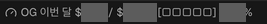

# OpenGateway Usage

Orca 하단에 **이번 달 사용액 / 현재 USD 잔액 · 사용 비중 게이지**를 표시하는 플러그인입니다. 기존 구독 서비스 위젯을 수정하지 않고 공식 `statusBarItems` 확장 지점에 한 항목을 추가합니다. 오른쪽 **OpenGateway Usage** 패널과 툴팁에서는 오늘 사용액, 상세 금액, 조회 시각도 확인합니다. 이 저장소의 루트가 설치 가능한 단일 플러그인입니다.

## 화면



v0.2.0이 실제 Orca에서 표시한 화면입니다. 2026-11-11 캡처에서 OpenGateway 항목만 잘라내고 실제 금액과 비율을 불투명하게 가렸습니다. 다른 서비스 사용량과 계정 정보는 포함하지 않았습니다.

표시 형식은 다음과 같습니다. 아래 숫자는 설명용 예시이며 스크린샷의 실제 값이 아닙니다.

```text
OG 이번 달 $40.00 / $60.00 [■■□□□] 40.00%
```

## 요구 사항과 연결

- macOS, `/Applications/Orca.app` 설치본. 현재 CLI 경로는 `/Applications/Orca.app/Contents/Resources/bin/orca`입니다. 앱 설치 위치를 옮기면 `src/browser.ts`의 경로를 수정하고 다시 설치해야 합니다.
- Orca 1.4.248 이상, 플러그인 기능 활성화. 개발 및 검증 기준 버전은 1.4.255입니다.
- **Orca 안의 브라우저**에서 https://opengateway.ai/analysis 에 로그인하고 팀을 선택해야 합니다. 로그인 직후 `/dashboard`에 머물러 있어도 조회합니다. Safari, Chrome, Aside의 로그인은 가져오지 않습니다.
- 현재 OpenGateway의 Clerk 세션을 사용합니다. 다른 인증 구현이나 향후 콘솔 변경에 대한 호환성은 보장하지 않습니다.

탭 선택 목록은 없습니다. 이전 버전에서 저장한 OpenGateway 탭이 있으면 해당 탭을 이어받습니다. 저장된 대상이 없는 첫 연결은 Orca의 `default` 브라우저 프로필에 전용 탭을 만듭니다. **OpenGateway 로그인/열기**에서 사용자가 직접 로그인하고 팀을 확인한 뒤 **이 계정·팀으로 연결**을 한 번 누르세요. 이후에는 저장한 프로필·작업공간·계정·팀을 재사용합니다.

전용 탭이 닫혔거나 다른 사이트로 이동했으면 같은 프로필·작업공간에서 새 탭을 자동으로 만듭니다. 열려 있는 다른 OpenGateway 탭을 임의로 선택하지 않습니다. 프로필·작업공간 정보를 확인할 수 없으면 중단합니다. 계정 또는 팀이 바뀌면 금액을 숨기고 새 연결 승인을 요구하며, 이전 연결을 자동으로 덮어쓰지 않습니다. 브라우저 탭과 로그인 세션 자체는 여전히 필요합니다. 완전한 브라우저리스 연동이나 보이지 않는 탭을 보장하는 방식은 아닙니다.

5분마다 자동 갱신하며 한국 시간 자정에도 갱신합니다. 하단 항목 클릭이나 패널의 **새로고침**으로 수동 조회할 수 있습니다. 조회 중에는 금액을 숨깁니다. 조회 결과가 로그인 만료·연결 실패·집계 미완료이면 금액 대신 상태를 표시하며, 0달러나 이전 조회 값으로 대체하지 않습니다. 화면의 금액은 표시된 마지막 조회 시각 기준입니다. 조회 이후에 발생한 로그인·계정·팀 변경은 다음 조회에서 확인됩니다.

## 금액과 기간의 의미

- **잔액:** 콘솔에서 선택한 팀의 일반 USD 계정 `balance`. 모델 전용 scoped credits를 합산하지 않습니다. 충전분과 보너스분을 별도 분리하는 기능은 없습니다.
- **오늘:** Asia/Seoul의 오늘 00:00부터 다음 날 00:00까지의 집계. 최근 24시간과 다릅니다.
- **이번 달:** Asia/Seoul의 이번 달 1일 00:00부터 다음 날 00:00까지의 집계.
- 사용액은 콘솔의 `spend-analysis` 응답 `totals.current.spend`입니다. 토큰 수로 요금을 추정하지 않습니다. 집계 자체의 지연은 있을 수 있습니다.
- **하단 금액:** USD 소수점 둘째 자리까지 반올림합니다. 아주 작은 사용액은 `$0.00`으로 보일 수 있습니다. 패널·툴팁은 2–6자리로 표시하며, 0이 아닌 0.000001달러 미만의 절댓값은 `<$0.000001`로 표시합니다. 음수 조정액은 음수 부호를 유지합니다.
- **사용 비중:** 반올림 전 `이번 달 사용액 / (이번 달 사용액 + 현재 잔액) × 100`. 월 예산이나 최초 충전액의 소진율이 아닙니다. 충전·보너스·조정으로도 변할 수 있습니다.
- **게이지:** SDK가 그래픽 진행 막대를 지원하지 않아 `■`·`□` 다섯 칸과 소수점 두 자리의 `%`를 표시합니다. 칸 수는 근삿값입니다. 실제 비중이 100% 미만이면 다섯 칸을 모두 채우거나 `100.00%`라고 표시하지 않습니다.
- 사용액과 잔액이 모두 0이거나 음수·유효하지 않은 값이면 비중을 계산하지 않고 `—`로 표시합니다. 오류를 0% 또는 100%로 치환하지 않습니다.

## 인증과 권한 경계

이 플러그인은 **비공식 콘솔 연동**입니다. 공개적으로 보장된 과금 API나 OpenGateway 공식 플러그인이 아닙니다. 콘솔 API, 응답 스키마, Clerk 인증 방식이 변경되면 조회가 중단될 수 있습니다.

`trusted-worker`는 샌드박스 제한형 플러그인이 아닙니다. 별도 Node.js 프로세스가 사용자의 로컬 계정 권한으로 실행됩니다. 이 권한을 이해하고 설치를 승인해야 합니다. 선언된 Orca capability는 `storage:own` 하나입니다. 저장소의 `connection`에는 탭 ID, 프로필 ID, 작업공간 ID, 계정·팀의 SHA-256 해시 지문을 보관합니다. 이전 `selected-tab-id`는 마이그레이션 후 삭제합니다. 해시 지문은 비밀번호나 토큰은 아니지만 연결 대상을 구분하는 지속 식별자이므로 공개하지 마세요.

실제 구현의 접근 범위:

1. 로컬 Orca CLI로 탭 메타데이터를 조회하고 저장된 대상만 재사용하거나 같은 범위의 전용 탭을 만듭니다.
2. 해당 탭의 URL·origin·프로필·작업공간을 확인합니다. 페이지 안에서 계정·팀의 해시 지문을 계산해 저장된 연결과 비교한 후에만 기존 Clerk 세션 토큰을 사용합니다. 최초 연결 확인용 지문 조회는 토큰을 얻거나 콘솔 과금 API를 호출하지 않습니다.
3. `https://apis.opengateway.ai/control-plane`의 다음 콘솔 경로만 호출합니다.
   - `POST /api/v1/users`: 콘솔의 기존 사용자 조회/갱신 경로. 로그인 및 선택된 팀이 있을 때만 호출합니다. 서버 의미상 create/get 경로이므로 순수한 GET 전용 API라고 표현하지 않습니다.
   - `GET /api/v1/teams/{teamId}/views/spend-analysis`: 오늘 및 이번 달, 각 한 번.
4. 플러그인으로 나오는 값은 금액, 기간, 시각, 고정 오류 코드와 연결 확인용 해시 지문뿐입니다. 쿠키·토큰·사용자 응답 원문·이메일·팀 목록을 복사하거나 저장하지 않습니다. 리다이렉트를 통한 토큰 전송도 허용하지 않습니다.
5. 조회 도중 로그아웃, 계정/팀 교체, 한국 시간 날짜 변경이 감지되면 결과를 폐기합니다. 연결 승인 직전에도 지문을 새로 확인하여 오래된 화면의 승인이 다른 계정을 연결하지 못하게 합니다. 페이지 조회 제한 시간은 20초이며, 초기 인증 SDK 준비에는 별도로 최대 약 2초를 기다립니다.

모델 추론, 결제, 충전, API 키 생성/변경, 계정 bootstrap/약관 동의 API는 호출하지 않습니다. `secrets:own` 권한이나 별도 API 키 설정도 필요하지 않습니다. 로그인 세션 자체의 저장과 만료 처리는 Orca 브라우저와 OpenGateway가 담당합니다.

## 정식 설치

### GitHub에서 설치

```sh
orca plugin install Arous/orca-plugins --json
```

버전을 지정하지 않으면 최신 버전 태그가 있으면 그 태그를, 없으면 기본 브랜치를 사용합니다. 실행 결과에 선택된 커밋이 표시됩니다. 최초 PR이 병합되기 전에는 기본 브랜치에 구현이 없으므로, PR 본문의 검토용 `--ref` 명령을 사용하세요. 아직 릴리스 태그를 발행하지 않았습니다.

처음 설치할 때 Orca가 반환하는 `approval_required`에서 실행 권한, 저장 권한, 저장소와 승인 지문을 확인하세요. 승인할 경우에만 반환된 정확한 `--approve` 명령을 실행합니다. 플러그인 기능이 꺼져 있다면 Orca Settings → Plugins에서 켭니다.

### 로컬 폴더에서 설치

아래 명령은 이 저장소 폴더 안에서 실행합니다.

```sh
npm prune --omit=dev --ignore-scripts --no-audit --no-fund
orca plugin inspect . --json
orca plugin install . --environment local --json
```

로컬 설치는 개발용 `node_modules`의 심볼릭 링크를 거부합니다. 검증 후 `npm prune --omit=dev`로 개발 도구를 제외하고 설치합니다. 다시 개발할 때는 `npm ci --ignore-scripts`로 복원합니다. 런타임 외부 패키지는 없습니다.

로컬 폴더의 설치 키는 `local.opengateway-usage`입니다. GitHub에서 설치하면 저장소 소유자가 publisher가 됩니다. 설치 결과의 `pluginKey`를 확인하세요. 두 설치 방식은 키와 저장소가 다르므로 기존 로컬 설치의 연결이 GitHub 설치로 자동 이전되지 않습니다. 두 설치본을 동시에 켜면 하단 항목이 중복될 수 있습니다.

개발 폴더를 연결하는 `plugin dev load/watch` 대신 정식 설치본을 사용합니다. 설치 후 소스 파일 편집은 설치본에 자동 반영되지 않습니다. 수정본은 다시 검증하여 설치합니다. 권한이 늘지 않는 업데이트는 기존 승인이 유지될 수 있으므로 `plugin install`을 읽기 전용 검사 명령으로 사용하지 마세요.

## Orca 업데이트와 복구

정식 설치본과 연결 설정은 앱 번들 밖에 있습니다.

- 설치본: `~/Library/Application Support/orca/plugins/<pluginKey>/`
- 플러그인 저장소: `~/Library/Application Support/orca/plugins-data/<pluginKey>/`

Orca의 일반 앱 업데이트는 `.app`을 교체하므로 위 사용자 데이터 경로와 분리됩니다. 정상적인 업데이트에서 플러그인과 연결 설정을 유지하는 구조입니다. 앱 데이터 삭제, 플러그인 제거, 호환되지 않는 플러그인 API 변경까지 보장한다는 뜻은 아닙니다.

하단 금액은 Orca의 임시 UI 상태입니다. 워커가 재시작되면 저장된 연결을 다시 찾아 새로 조회하고 하단 항목을 복원합니다. 금액 자체를 디스크에 보관하거나 오래된 잔액을 먼저 표시하지 않습니다. 탭이 없어지면 같은 프로필·작업공간에서 자동으로 재생성합니다. 로그인 만료는 사용자가 다시 로그인해야 하고, 저장한 프로필·작업공간이 없어지거나 메타데이터를 확인할 수 없으면 자동으로 다른 대상으로 바꾸지 않습니다.

플러그인 워커를 중지하면 다음 명령이나 패널 요청에서 다시 시작합니다. 아래는 로컬 설치의 예시입니다. GitHub 설치는 설치 결과나 `orca plugin list --json`에 나온 `pluginKey`를 사용하세요.

```sh
orca plugin restart local.opengateway-usage --environment local --json
```

재시작 검증은 실제 Orca 앱 업데이트 검증과 구분해야 합니다. 사용 중인 앱의 업데이트/종료를 이 플러그인 설치 과정에서 자동으로 수행하지 않습니다.

## 개발 검증

프로덕션 외부 패키지 의존성이나 빌드 단계는 없습니다. Orca가 TypeScript/TSX를 로드합니다. Node 24 기준 개발 도구만 lockfile에 고정되어 있습니다. `.orca/types/`는 설치된 Orca가 생성하는 SDK 선언이며 Git에 포함하지 않습니다. 새로 clone한 뒤에는 먼저 타입을 생성하세요.

```sh
orca plugin types . --json
npm ci --ignore-scripts --no-audit --no-fund
npm run typecheck
npm test
npm run check
```

`collector.test.ts`는 KST 경계, 응답 스키마, 집계 미완료, 인증·계정·팀 교체와 지문 조회의 정보 경계를 검증합니다. `worker.test.ts`는 연결 승인 경쟁 상태, 닫힌 탭 복구, 재활성화와 프로필 경계를 가짜 브라우저 전송 계층으로 검증합니다. `presentation.test.ts`는 비중 산식과 0·음수·100% 경계를 검증합니다. 합성 테스트나 패널 렌더 검증은 실제 계정 금액 대조와 실제 탭 복구 확인을 대체하지 않습니다.

`plugin check`는 코드 실행 검사이므로 신뢰하는 코드에만 사용합니다. 자동 연결 워커가 실제 로컬 Orca 브라우저에 탭을 만들 수 있어 `npm run check`는 macOS `sandbox-exec`로 네트워크를 차단합니다. 이 검사는 초기 패널 렌더만 증명하며, 실제 연결과 준비 완료 화면은 별도로 확인해야 합니다.

실제 확인에서는 계정 연결 후 하단 금액과 게이지를 확인하고, 새로 만든 검증용 탭을 닫은 뒤 같은 프로필·작업공간에서 복구되는지 확인합니다. 기존 사용자 탭을 검증 목적으로 닫거나 계정을 임의로 바꾸지 마세요. 워커 재시작 후에도 저장한 연결이 유지되어야 합니다.

## 코드 구성

| 파일 | 역할 |
| --- | --- |
| `src/browser.ts` | 로컬 Orca CLI를 통한 전용 탭 생성, 범위 확인과 복구 |
| `src/collector.ts` | 브라우저 내부의 계정 확인과 콘솔 사용액 조회 |
| `src/worker.ts` | 연결 저장, 승인 처리, 주기적 조회와 하단 갱신 |
| `src/protocol.ts` | 패널 요청, 상태와 브라우저 연동 타입 |
| `src/presentation.ts` | 금액 표시, 사용 비중과 문자형 게이지 |
| `src/panel.tsx` | 연결 안내와 상세 사용량 패널 |
| `src/*.test.ts` | 조회, 연결 상태 전이와 표시 경계의 회귀 검사 |

## 변경 기록

### 0.2.0

- 수동 탭 선택 제거. 연결 대상 저장, 같은 프로필·작업공간의 전용 탭 자동 생성·복구 및 기존 탭 설정 마이그레이션.
- 계정·팀 해시 지문을 한 번 확인하여 고정하고, 변경 감지·오래된 승인·조회 중 계정 전환 시 금액 노출 차단.
- 하단을 이번 달 사용액 / 현재 잔액의 두 자리 USD 표시와 문자형 사용 비중 게이지·퍼센트로 통합. 오늘 사용액과 정밀 금액은 패널·툴팁에 유지.

### 0.1.1

- 로그인 직후 `/dashboard`에 도착한 탭을 탐색·조회 대상에 포함하여 인증된 세션을 놓치던 문제 수정.
- 열기 주소와 안내를 콘솔 메뉴의 실제 사용량 경로 `/analysis`로 정정.

### 0.1.0

- 공식 상태 표시줄 확장과 의미론적 패널을 통한 USD 잔액·오늘·이번 달 표시.
- Orca 브라우저 내 세션 사용, 비밀 정보 미복사, 명시적 탭 연결 및 실패 상태.
- KST 달력 기간, 5분/자정 갱신, 워커 재시작 시 연결 복구.

## 근거

- [Orca plugin authoring](https://github.com/stablyai/orca/blob/ccd4592634f5aeca03c58b80a36c619432211fa7/docs/reference/plugin-authoring.md)
- [Orca plugin discovery](https://github.com/stablyai/orca/blob/ccd4592634f5aeca03c58b80a36c619432211fa7/src/main/plugins/plugin-discovery.ts)
- [Orca plugin startup](https://github.com/stablyai/orca/blob/ccd4592634f5aeca03c58b80a36c619432211fa7/src/main/startup/main-process-plugins.ts)
- [OpenGateway billing](https://opengateway.ai/docs/platform/billing)
- [OpenGateway usage console](https://opengateway.ai/analysis)
